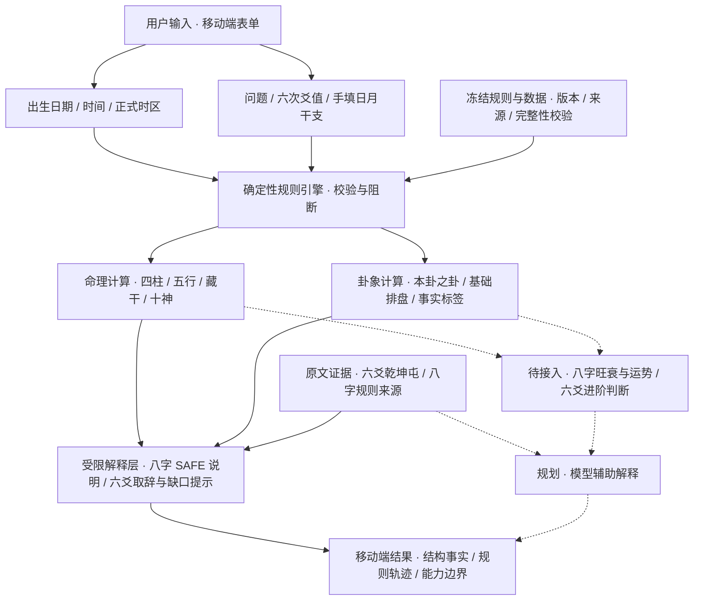

# 周易决策工具

**手机优先的周易研究与问事辅助工具。** 从出生资料或一件具体事情出发，把规则计算、传统文献依据与解释边界放在同一条可追溯的流程里，帮助使用者核对结构、阅读原文、整理思考。

目前是基础能力已接入的研究型 Web 应用，尚不是完整命理或占断产品。结果用于学习、研究与个人决策参考；不承诺预测准确率，也不提供神秘能力或必然结论。

## 两个入口，两条规则链

| 模块 | 用户价值 | 已实现并接入页面 | 开发中 / 待接入 | 未实现 / 未开放 |
| --- | --- | --- | --- | --- |
| **生辰八字** `/bazi/` | 核对出生时间与四柱，理解基础命理结构 | 公历出生资料、中国大陆北京时间或手选 IANA 时区；确定性年/月/日/时柱；未知时辰保留三柱；阴阳五行、藏干、十神关系；受限传统主题说明与结构事实报告 | 解释编排及旺衰相关事实入口已存在，仍只输出事实，后续判断规则待完善；不代表完整命理解读 | 农历输入、真太阳时、身强身弱评分、格局、喜用神、神煞、大运、流年及个人运势判断 |
| **六爻问事** `/liuyao/` | 明确一件事，核对卦盘并按规则阅读原文 | 手动逐爻录入 6/7/8/9；本卦、之卦、动爻、占变取辞；纳甲、世应、六亲、六神；日月关系、三合、旬空、回头生克与进退神事实标签；乾、坤、屯原文 | 进阶判断入口保留阻断状态，规则仍待接入；问题类型可生成用神候选集合，但不作最终选定 | 最终用神裁决、综合旺衰、事情进展、阻碍、吉凶与结局；随机起卦、铜钱模拟、自动历法推导日干/月建/日辰 |

“已实现”指实际代码和页面接入存在，**不等于本机端到端验收通过**；“开发中”表示有研究资料、事实层或阻断入口，不承诺开发进度与交付时间。当前首页部分状态文案仍滞后，能力以实际模块链路为准。

六爻的卦盘计算与原文覆盖是两回事：卦盘可以计算，原文库仅收录 **乾、坤、屯**，其余 61 卦不补写原文。三爻动保留取辞证据，但自动主次裁决被阻断。八字的十神数量、月令、藏干成员与通根存在事实，也不等同于性格、旺衰或人生判断。

## 核心架构

实线是已接入代码的链路，虚线是规划或待接入的能力；虚线节点不参与当前结果生成。



- **交互层**：Next.js App Router + React + TypeScript，首页连接两个模块；响应式样式优先适配手机。
- **规则层**：八字先解析地点与时区、标准化民用时间，再计算四柱；六爻按输入爻值与日月干支生成卦盘、关系标签和取辞目标。
- **证据层**：`data/frozen/` 保存冻结协议与数据，`public/` 提供浏览器运行时资产。六爻原文按来源标识展示；八字来源与语义标识用于规则追溯，不表示页面已提供完整古籍原文阅读。
- **解释层**：八字编排正式运行时事实与允许的传统语义；六爻分开呈现原文、资料缺口和反思提示，当前不生成模型推断。`research/` 是研究材料，不代表产品运行时已接入。

实现入口：[八字计算链](src/lib/bazi/bazi-deterministic-pipeline.ts) · [八字解释编排](src/components/bazi/bazi-explanation-runtime-adapter.ts) · [六爻排盘](src/lib/liuyao/rules.ts) · [占变取辞](src/lib/divination.ts)。

## 为什么这样设计

**规则可追溯。** 尽量保留命中规则、数据版本、来源标识和阻断原因，让使用者可以核对结果依据，而不是只接受一句结论。

**计算确定性。** 相同输入、参考时刻和规则数据产生相同计算结果；当前不使用随机或模型代替规则计算。时间歧义、数据缺失和完整性失败会明确阻断，不猜补时辰或资料。

**原文证据与解释分离。** 卦辞、《彖传》、爻辞和《小象》分别呈现；八字结构事实与传统主题说明分层。规则内部的一致性不代表现实预测有效性，事实标签不自动升级为个人判断。

## 在手机上怎么使用

首页选择模块，按顺序填写资料，提交后查看结构、规则轨迹与限制提示。仓库没有可核验的产品截图，本页不展示模拟界面或伪造效果；以下流程依据现有组件说明，未声称完成手机实机验收。

### 生辰八字

1. 输入公历出生日期与当地钟表时间；不知道准确时辰时选择未知，不填替代时间。
2. 选择中国大陆北京时间，或填写出生地名称并从正式目录选择 IANA 时区。城市名称仅用于显示，性别暂不参与基础四柱计算。
3. 提交基础排盘；遇到夏令时回拨重叠时选择较早或较晚时刻，其他阻断按提示处理。
4. 查看三柱或四柱、五行/藏干/十神、受限解释报告与来源轨迹；页面支持复制摘要，复制内容由使用者自行保管。

### 六爻问事

1. 明确一件具体事情，填写问题标题、时间范围、类型，以及日干、月建、日辰；系统不从问题文本推导历法数据。
2. 自下而上完成六次爻值录入：6 老阴、7 少阳、8 少阴、9 老阳。
3. 查看本卦、之卦、动爻、基础卦盘 JSON 与取辞目标；原文未收录或主次不可自动裁决时，保留缺口提示。
4. 根据证据自行整理机会、风险、成立条件与下一步可验证行动，不把事实标签当作必然结果。

## 安装、运行与验证

需要 Node.js 与 npm；规则验证另需 Python 3。当前测试命令使用 Node 的 TypeScript 去类型能力，建议使用 Node.js 24。常规安装使用仓库锁文件，不需要模型账号或 API 密钥。

```powershell
git -c core.autocrlf=false clone --branch master https://github.com/hcxhcx1981-hash/zhouyi-decision-tool.git
cd zhouyi-decision-tool
npm ci
npm run dev:3036
```

开发入口为 `http://127.0.0.1:3036`，首页路径 `/`，模块路径 `/bazi/` 与 `/liuyao/`。Windows 也可使用 [start-dev.bat](start-dev.bat)。

**Windows 注意：** 浏览器资产按原始字节校验 SHA-256。自动把 LF 转为 CRLF 会导致资产完整性校验失败，因此上面的克隆命令只对本次 clone 禁用转换，不修改全局 Git 设置。已有 CRLF 工作区应先保护本地改动，再另建保持原始行尾的干净检出；不要手工改写冻结数据或绕过校验。

| 操作 | 仓库已有命令 | 作用 |
| --- | --- | --- |
| 规则校验 | `npm run validate:rules` | 周易规则结构与冻结案例验证 |
| 回归测试 | `npm test` | 确定性引擎、页面契约与运行时测试 |
| 类型与代码检查 | `npm run typecheck`、`npm run lint` | TypeScript 与 ESLint 检查 |
| 生产构建 | `npm run build` | 静态导出至 `out/` |
| 发布产物审计 | `npm run release:audit` | 在构建后检查静态产物与发布边界 |

项目配置使用 `output: "export"`，生产交付应托管 `out/` 静态文件；不把 `npm start` 当作静态导出的部署方法。部署说明见 [静态部署](docs/CLOUDBASE_STATIC_DEPLOY.md) 和 [发布检查清单](docs/CLOUDBASE_TEST_RELEASE_CHECKLIST.md)。

## 当前状态、限制与隐私

- **阶段**：包版本为 `0.1.0`；基础计算、证据展示与受限解释已有代码，高阶判断仍未开放。冻结版本分别演进，不用包版本代替规则版本。
- **八字输入范围**：公历出生日期从 1970-01-01 到所选时区的当前民用日期；不接受未来出生日期。未知时辰不生成时柱，节气边界与时间歧义可能阻断输出。
- **本次核查（2026-10-12）**：Windows 10 新克隆工作区的周易规则校验通过；`npm test` 为 163 通过、10 失败，涉及浏览器资产行尾造成的完整性错误和缺少 React 依赖。typecheck、lint、build 因未安装依赖无法执行成功；未安装工具或修复代码，未进行页面/API端到端验证。此记录不代表其他平台或部署环境的验收结果。
- **隐私边界**：现有表单使用浏览器内存状态，未发现用户资料上传、数据库存储或浏览器持久化链路；八字会请求本站静态运行时数据。此代码核查不构成托管平台日志、浏览器扩展或第三方部署的隐私保证。
- **分享边界**：不要向 Issue、PR、截图或日志提交真实出生资料、姓名、问事内容、卦盘记录、凭据或浏览器数据；测试与反馈使用匿名示例。复制摘要可能包含出生资料，请自行控制传播。
- **服务边界**：当前未接入模型服务、登录、支付或数据库。模型辅助解释仅为规划；无需为了现有功能填写密钥。
- **决策边界**：不将结果作为医疗、法律、投资或人身安全事项的唯一行动依据。

## 深入阅读与参与

从 [实际页面入口](src/app/page.tsx)、[冻结规则目录](data/frozen/) 和 [测试目录](tests/) 核查当前实现。历史 [产品架构文档](docs/PRODUCT_ARCHITECTURE_V0.1.md) 提供阶段背景，若与实际代码不一致，以当前链路为准。

欢迎提交可复现问题、文献来源和规则或交互改进建议。项目采用 [MIT License](LICENSE)；第三方资料另见 [节气数据声明](research/bazi/THIRD_PARTY_NOTICES_SOLAR_TERM.md) 与 [时区数据声明](research/bazi_timezone/THIRD_PARTY_NOTICES_TZDATA.md)。
